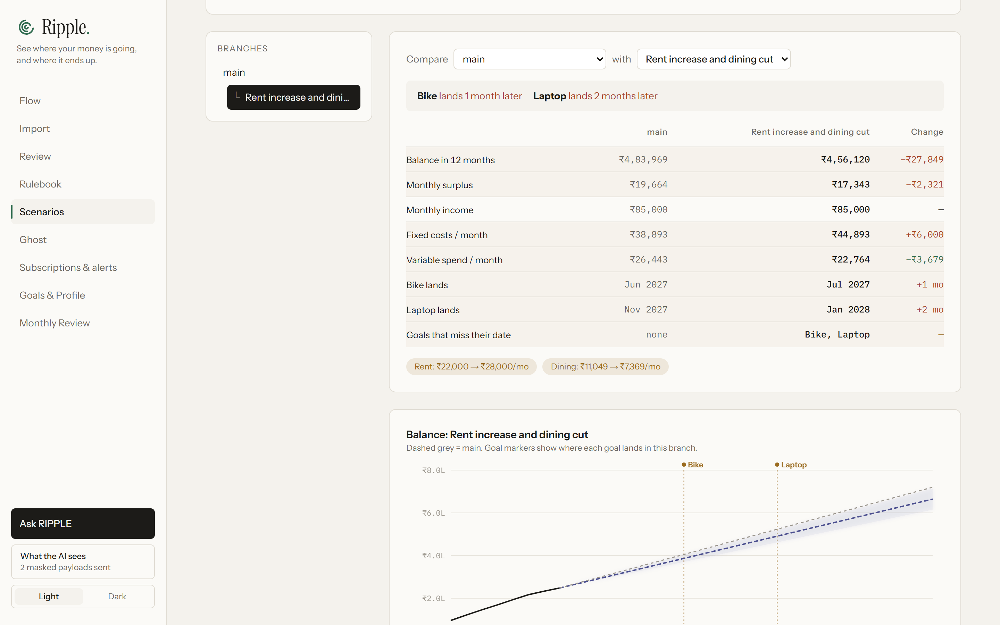

<p align="center">
  
</p>

<p align="center"><strong>See where your money is going, and where it ends up.</strong></p>

<p align="center">
  <a href="https://ripple-psi-gold.vercel.app"></a>
  
  
  
  
  
</p>

<p align="center">
  <a href="https://ripple-psi-gold.vercel.app"><strong>Open the live demo →</strong></a> &nbsp;·&nbsp; one click on "Load demo data", no sign-up
</p>

---

Product Space Agentic AI Hackathon, **PS04: personal finance coach with a living money model.**

## The problem

Budgeting apps show you a pie chart of last month and stop there: when they get a category wrong, you fix it and nothing is learned. They cannot answer "what happens to my bike goal if rent goes up?", and they never show you what ignoring their own advice has cost. For most Indians the raw material is not a tidy bank export at all but a stream of bank SMS alerts and UPI screens, which those apps were not built for.

RIPPLE keeps a running model of your money that you can correct, branch and question, and it shows its working for every number.

## Screens

**Flow: the invisible salary, the regret number and where the money went, above the fold.**


**Scenarios: "what if rent goes up by 6000 and I cut eating out by a third", parsed into editable assumptions, then diffed against main.**



**Ghost: the balance of the version of you that took the advice, and the gap.**


## What makes it different

**An investigation agent that drives the engine.** Ask "why am I falling behind on the bike goal?" or "I want an iPhone 18 for ₹1,40,000 in 4 months, how do I save for it?" under **Investigate**. The model plans a chain of up to five tool calls over RIPPLE's own deterministic engine (`query_transactions`, `get_recurring`, `get_goals`, `get_profile`, `get_category_trend`, `run_projection`, `create_scenario`, `create_goal`), and each step appears as it completes: the call, a one-line finding our code writes, and the rows it touched, clickable. It ends with one action you approve (a scenario, a new goal, or both), derived from a step in that chain and citing it. It never guesses a price: with none stated, it asks. The model chooses and explains; every figure is computed by the engine.

**Plain-language bulk rules.** On Review, type "put all entries of Maheshwari Mart and Pintu Kumar as stationery". RIPPLE turns it into one rule per merchant, creates the Stationery category if it doesn't exist, and previews each rule with how many rows it matches, editable, before anything applies. Anything it can't match to your data is named, not guessed. These rules sit in the Rulebook beside the learned ones, marked with the instruction they came from.

**A glass-box rulebook that learns from corrections.** Fix one transaction and the model proposes a general rule ("if the description contains BHAGWATI TIFFIN SERVICE, the category is Dining"). You see it in plain English with a live match count, edit it, confirm it, and it re-applies over your history: on the demo data, 14 past rows update at once. Every rule is listed in the Rulebook with its source transaction, and can be edited, disabled or deleted. Guesses the model makes about a merchant you have never confirmed are never applied silently: they wait in Review until you accept or fix one.

**Scenario branching with a diff.** Type a "what if" sentence. The model only reads it into parameters (rent +₹6,000, dining −33.3%), shown as editable fields before anything runs. Scenarios have parents, so they build on each other; `main` cannot be deleted. The diff view compares any two: balance in 12 months, monthly surplus, each goal's landing month, and which goals miss their date.

**The Regret Engine.** Every piece of advice you did not take keeps its promised monthly saving, banked from the month after it was given at a plain savings rate. The ghost line is your balance plus that pot; the regret number is the gap today, and clicking it opens the payments that show the advice was not followed (the gym membership still charging every month, for example).

**Indian inputs first.** Paste a dump of HDFC, ICICI, SBI or Axis SMS alerts (the demo has 361), upload a bank CSV, an Excel export (`.xlsx`/`.xls`, including Paytm and PhonePe passbooks, read entirely in the browser), or a PDF statement. UPI handles, P2P transfers and POS strings are normalised into merchants. Duplicates across sources are reported, never silently merged.

**The invisible salary.** One number, shown large: fixed costs plus subscriptions as a share of income, the part of your salary that is spent before it arrives (46% on the demo profile).

**The goal-impact lens.** Every debit carries "+N days on your bike goal" (amount ÷ monthly surplus × 30). Nudges, subscriptions and the recurring table speak in the same unit, so a ₹2,400 dinner and a ₹1,299 gym membership are comparable at a glance.

Also: subscription alerts (price changes, new recurring payments, a graveyard with the yearly total), income and fixed-cost shift detection with a one-tap re-plan, an uncertainty cone on every projection, provenance on every figure (click any number to see the rows behind it), a printable monthly review, and warm light and dark themes.

## Where AI is used, and where it deliberately is not

**No rupee figure in RIPPLE is ever produced by a language model.** Balances, projections, goal dates, totals, averages, surplus, rule match counts, recurring detection, nudge thresholds, the ghost line and goal-impact days are all arithmetic in [`src/lib/engine/`](src/lib/engine), covered by unit tests.

The model (Groq, `openai/gpt-oss-120b` and `gpt-oss-20b`, through the Vercel AI SDK with zod-typed structured output) is called for exactly these jobs:

| Call | Route | What the model returns |
|---|---|---|
| Categorize unknown merchants | `/api/categorize` | category, confidence and a clean merchant name, 40 per batch, cached per merchant |
| Propose a rule from one correction | `/api/propose-rule` | rule type and pattern, shown editable before it applies |
| Read a "what if" sentence | `/api/scenario` | assumption parameters the user literally stated, shown editable before it runs |
| Read a text-layer PDF statement | `/api/vision` | transcribed rows, in parallel chunks of about 15 |
| Parse SMS the regex cannot | `/api/sms-fallback` | transcribed fields for that message |
| Explain a subscription price change | `/api/explain` | one sentence of words |
| Write the monthly review | `/api/narrative` | prose with `{placeholders}` |
| Coach answers and refusals | `/api/coach` | prose with `{placeholders}`, plus an out-of-scope flag |
| Investigation agent, one step at a time | `/api/investigate` | the next tool to call and its arguments, or a word-only conclusion; tools run in our engine |
| Plain-language bulk rules | `/api/bulk-rules` | which merchants and which category; every merchant is checked against your data |

Three fences keep it honest:

- **Placeholders, not numbers.** Prose from the model refers to figures as `{surplus}`, `{goal_date}` and so on; our code fills them in. If the model writes a digit itself, the text is rejected and a template is used.
- **Masked before every call.** Every payload is tokenized at the single point where it is built: each person's name in your data becomes `[NAME_n]` in every form our code derives from it, including ids like `rec_ramesh_kulkarni`; account and card numbers become `XX1234`, phone numbers `[PHONE]`, UPI handles `[UPI-ID]`. A test drives every model route and fails if any demo name reaches a call. The exact payloads are listed in the app under "What the AI sees".
- **A fallback for every path, and you can see it.** No key, a quota error, a timeout or bad JSON drops to a deterministic path: heuristics and templates, RIPPLE's own PDF statement parser, a fixed investigation chain. The sidebar says "Running on fallback model" or "AI unavailable · running on templates" when that happens; figures are unaffected either way.

**Guardrails.** RIPPLE educates and models; it does not recommend securities, funds or insurance. Ask "which mutual fund should I buy" and it says so plainly, explains the concept (what a fund or SIP is), and shows the monthly amount, computed by us, that reaches your goal by its date. Refusals are logged and visible.

## Architecture

```
SMS / CSV / Excel / PDF ──► parsers (src/lib/ingest) ──► Transaction[]  (contract/types.ts)
                                                     │
                      rules → starter list → model batch  (categorize)
                                                     │
                                Zustand store, persisted to localStorage
                      (source data only: transactions, rules, goals, scenarios, advice)
                                                     │
                 engine/ recomputes on read: recurring · baseline · projection ±1σ
                 · goals · scenarios · nudges · shifts · ghost · goal impact
                                                     │
                     screens (src/components) ◄── provenance on every figure
```

Nothing derived is ever stored. A new rule, an accepted piece of advice or an edited goal recomputes every screen, which is where the name comes from.

Stack: Next.js 16 (App Router) and TypeScript, Tailwind v4 with a single token file, Recharts 3 (Sankey, area bands), Zustand, Vercel AI SDK 7 with `@ai-sdk/groq`, unpdf, deployed on Vercel. No database, no Python, no Monte Carlo.

## PS04 requirements

| # | Requirement | Where it lives |
|---|---|---|
| 1 | Ingest messy bank data, categorize automatically | Import screen; `src/lib/ingest/` (SMS, CSV, Excel), `src/lib/engine/categorize.ts`, `/api/categorize`, `/api/vision` |
| 2 | Correction loop that learns the rule | Review screen, rule modal, plain-language bulk rules, Rulebook; `/api/propose-rule`, `/api/bulk-rules`, `src/lib/engine/bulk-rules.ts` |
| 3 | Recurring and subscription detection, alerts on change or non-use | Subscriptions & alerts; `src/lib/engine/recurring.ts`, `shifts.ts`, `/api/explain` |
| 4 | Persistent financial profile | Goals & Profile; `src/lib/store.ts` (persisted), `src/lib/seed.ts` |
| 5 | Goal planner with what-if simulation | Flow, Scenarios and the investigation agent; `src/lib/engine/projection.ts`, `scenario.ts`, `investigate.ts`, `/api/scenario`, `/api/investigate` |
| 6 | Nudges when spending drifts | Flow and Subscriptions & alerts; `src/lib/engine/nudges.ts` |
| 7 | Monthly review report | Monthly Review (printable); `src/lib/engine/review.ts`, `/api/narrative` |
| 8 | Clear guardrails | Ask RIPPLE coach, refusal log, footer line; `src/lib/engine/coach.ts`, `/api/coach` |

## Run it locally

```bash
git clone https://github.com/RAK2315/ripple && cd ripple
npm install
cp .env.example .env.local        # then set GROQ_API_KEY (optional)
npm run dev                       # http://localhost:3000
```

| Variable | Needed for | Without it |
|---|---|---|
| `GROQ_API_KEY` | model categorization, rule proposals, scenario reading, PDF rows, narrative, coach | every path falls back to deterministic heuristics and templates |

`npm test` runs the engine, parser and privacy tests (85). `node scripts/walk.mjs <dir>` drives a local Chrome through the whole demo path, screenshots every step and reports console errors (`BASE=<url>` points it at a deployment). Demo inputs live in `public/demo/`.

## Known limitations

- **"Unused" is inferred and confirmed, not detected.** A bank statement cannot show whether you use a subscription. RIPPLE infers it (a discretionary charge with no related spending) and asks; the user's mark is what counts.
- **Vision inputs need a vision-capable key.** UPI screenshots and scanned PDFs need a vision model. The free Groq key used here has none, so those tabs say so and point to SMS or CSV. PDFs with a text layer work, through the model or, when it is unavailable, RIPPLE's own parser. Uploads are capped at 3 MB.
- **Free-tier quota.** The Groq free tier allows 200k tokens a day on the larger model. When it runs out, features drop to their deterministic paths and the sidebar says so.
- **Income needs about three months of history.** Salary is detected as a regular monthly credit. With a shorter import, every screen says income was not detected and asks you to enter it.
- **Model categorization varies between runs.** Unconfirmed guesses always land in Review, so a wrong one is visible and fixable, but two fresh runs can disagree on the same merchant.
- **The advice history is seeded.** The demo profile is a user who has had RIPPLE for six months; the ghost line needs that history to exist on day one.
- **Projections are trailing averages, not simulation.** The cone is the average ±1 standard deviation of the last six months. "Today" is pinned to 20 Nov 2026 so the demo is stable.
- **Your data stays in your browser.** No accounts, no server storage and no sync between devices. That is also the privacy model.

## Repository

| Path | What it is |
|---|---|
| `src/` | the app: screens, API routes, the pure engine |
| `contract/`, `CONTRACT.md` | the frozen ingestion interface and the demo fixture |
| `CONTEXT.md` | product, stack and architecture in one page |
| `PRAVAH_SPEC.md` | the full product spec (PRAVAH was the working name) |
| `rehaan/PLAN.md`, `kirti/BRIEF.md` | the build plan and the ingestion brief the team worked from |
| `scripts/` | fixture generator, browser walkthrough, demo recorder |

Built by Rehaan and Kirti. MIT licensed.
