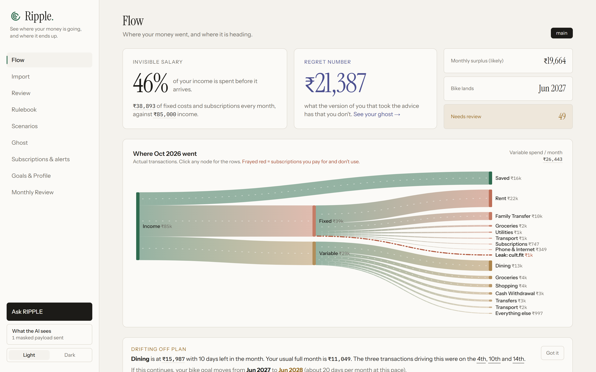
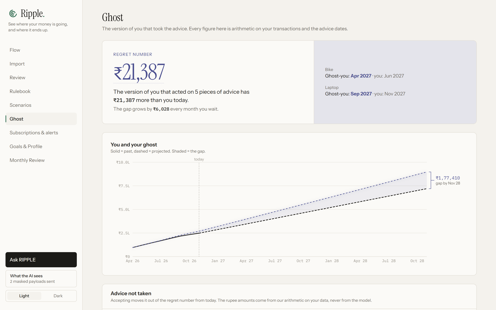
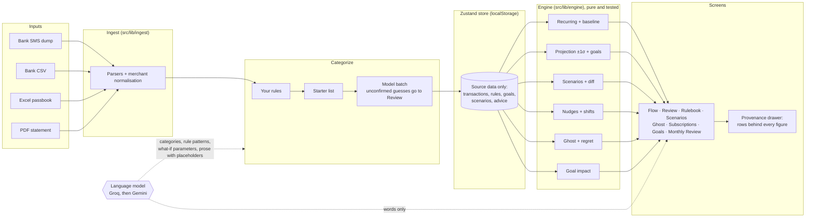
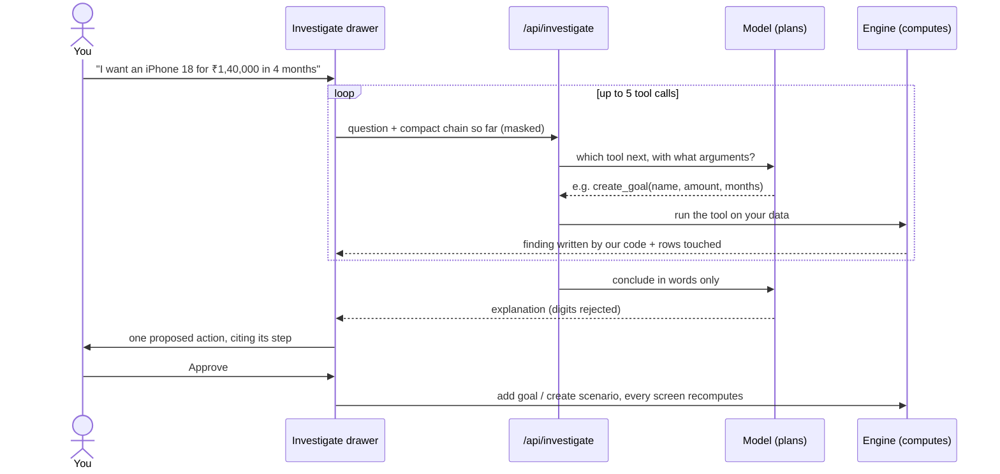
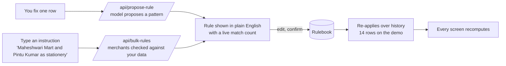
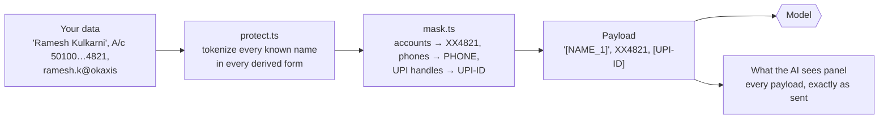
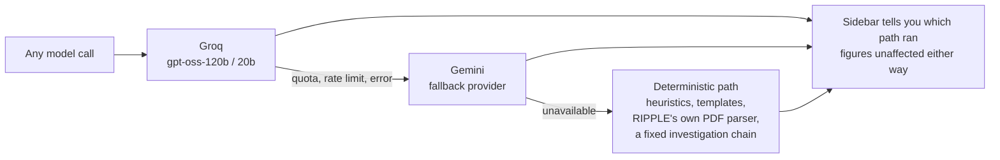

<p align="center">
  
</p>

<p align="center"><strong>See where your money is going, and where it ends up.</strong></p>

<p align="center">
  <a href="https://ripple-psi-gold.vercel.app"></a>
  
  
  
  
  
</p>

<p align="center">
  <a href="https://ripple-psi-gold.vercel.app"><strong>Open the live demo →</strong></a> &nbsp;·&nbsp; one click on "Load demo data", no sign-up, nothing to install
</p>

---

**Product Space Agentic AI Hackathon, PS04: personal finance coach with a living money model.**
Built by team **kirtiii.work** (Rehaan and Kirti).

RIPPLE turns the money messages you already get (bank SMS, UPI alerts, statements) into a **living model of your finances**: one you can **correct**, **branch** and **question**, and one that **shows its working for every number**. Paste a messy SMS dump and within seconds you see where your salary really goes, when each goal lands, what a rent increase would do to it, and what skipping past advice has cost you, in rupees.

> **The promise behind every screen:** no rupee figure in RIPPLE is ever produced by a language model. The model reads, labels and writes words. Our tested engine does all the arithmetic, and every figure opens the exact rows behind it.

## Contents

- [At a glance](#at-a-glance)
- [The problem](#the-problem)
- [What RIPPLE does](#what-ripple-does)
- [A two-minute tour](#a-two-minute-tour)
- [Screens](#screens)
- [Architecture](#architecture)
- [Where AI is used, and where it deliberately is not](#where-ai-is-used-and-where-it-deliberately-is-not)
- [Privacy](#privacy)
- [Reliability: a fallback for every path](#reliability-a-fallback-for-every-path)
- [Guardrails](#guardrails)
- [PS04 requirements](#ps04-requirements)
- [Engineering quality](#engineering-quality)
- [Run it locally](#run-it-locally)
- [Repository map](#repository-map)
- [Scope and honest limits](#scope-and-honest-limits)
- [Team](#team)

## At a glance

| | |
|---|---|
| **Input** | Raw bank SMS (HDFC, ICICI, SBI, Axis), bank CSV, Excel passbooks (Paytm, PhonePe), text-layer PDF statements |
| **Demo data** | 361 SMS parsed, 315 categorized at once, 46 routed to Review for one-tap confirmation |
| **Headline insight** | The **invisible salary**: 46% of the demo salary is spent before it arrives |
| **Agentic surfaces** | An **investigation agent** that plans up to five tool calls over the engine, and **plain-language bulk rules** |
| **Signature feature** | The **Regret Engine**: ₹21,387 between you and the version of you that took the advice |
| **Trust** | Every figure is clickable to its source rows; every model payload is visible and masked |
| **Quality** | 85 tests (engine, parsers, privacy), TypeScript strict, 0 console errors on the deployed walk |

## The problem

Most Indians do not experience money as a tidy bank export. It arrives as a stream of SMS alerts and UPI screens, hundreds a month, and almost none of it turns into an answer.

Budgeting apps help a little, then stop:

1. **They only look back.** A pie chart of last month, and nothing about where you are heading.
2. **They never learn.** Fix a wrong category this month and you fix it again next month.
3. **They cannot answer "what if".** What does a ₹6,000 rent increase do to the bike you are saving for?
4. **They forget their own advice.** Nobody shows what ignoring it has actually cost you.

RIPPLE is built around exactly these four gaps.

## What RIPPLE does

### 1. An investigation agent that drives the engine

Ask a real question under **Investigate**: "Why am I falling behind on the bike goal?" or "I want an iPhone 18 for ₹1,40,000 in 4 months. How do I save for it?"

The model **plans** a chain of up to five tool calls over RIPPLE's own deterministic engine:

`query_transactions` · `get_recurring` · `get_goals` · `get_profile` · `get_category_trend` · `run_projection` · `create_scenario` · `create_goal`

Each step appears as it completes, with the call, a one-line finding **our code** writes, and the rows it touched (clickable). It ends with **one action you approve** (a scenario, a new goal, or both), derived from a step in the chain and citing it. On the demo data it finds you would be short by ₹16,078 a month for the iPhone, then proposes a cut that brings every goal forward. It never guesses a price: with none stated, it asks.

### 2. Plain-language bulk rules

On Review, type "put all entries of Maheshwari Mart and Pintu Kumar as stationery". RIPPLE turns that into one rule per merchant, creates the **Stationery** category if it doesn't exist, and previews each rule with how many rows it matches (3 and 2 on the demo), editable, before anything applies. Anything it can't match to your data is named, never guessed. These rules sit in the Rulebook beside the learned ones, marked with the instruction they came from.

### 3. A glass-box rulebook that learns from corrections

Fix one transaction and RIPPLE proposes a general rule in plain English ("if the description contains BHAGWATI TIFFIN SERVICE, the category is Dining"), with a **live match count**. Edit it, confirm it, and it re-applies over your history: on the demo data, **14 past rows update at once**. Every rule is listed in the Rulebook with its source transaction and can be edited, disabled or deleted. Guesses about a merchant you have never confirmed are never applied silently: they wait in Review until you accept or fix one.

### 4. Scenario branching with a diff

Type a "what if" sentence. RIPPLE reads it into parameters (rent +₹6,000, dining -33.3%) shown as **editable fields** before anything runs. Scenarios have parents, so they build on each other, and `main` cannot be deleted. The diff view compares any two: balance in 12 months, monthly surplus, each goal's landing month (bike Jun 2027 to Jul 2027 on the demo), and which goals miss their date.

### 5. The Regret Engine

Every piece of advice you did not take keeps its promised monthly saving, banked from the month after it was given at a plain savings rate. The **ghost line** is your balance plus that pot; the **regret number** is the gap today, and clicking it opens the payments showing the advice was not followed (the gym membership still charging every month, for example). Generate fresh advice from your own data at any time.

### 6. Indian inputs first

Paste a dump of HDFC, ICICI, SBI or Axis SMS alerts, upload a bank CSV, an Excel export (`.xlsx`/`.xls`, including Paytm and PhonePe passbooks, read entirely in your browser), or a PDF statement. UPI handles, P2P transfers and POS strings are normalised into merchants. Unknown Excel layouts get a column-mapping screen. Duplicates across sources are reported, never silently merged.

### 7. The invisible salary

One number, shown large: fixed costs plus subscriptions as a share of income, the part of your salary that is spent before it arrives (**46%** on the demo profile).

### 8. One unit for every decision: goal impact

Every debit carries "+N days on your bike goal" (amount ÷ monthly surplus × 30). Nudges, subscriptions and the recurring table speak the same unit, so a ₹2,400 dinner and a ₹1,299 gym membership are comparable at a glance.

### And more

- **Subscriptions and alerts:** price changes explained in one sentence, new recurring payments, and a **graveyard** of subscriptions you don't seem to use, with the yearly total (₹15,588 on the demo).
- **Drift nudges** when a category runs ahead of its usual month, with the three transactions driving it and the goal it moves.
- **Income and fixed-cost shift detection** with a one-tap re-plan.
- **An uncertainty cone** on every projection, and a timeline scrubber into the future.
- **Provenance everywhere:** click any figure to see the rows behind it.
- **A printable monthly review** with a narrative written around computed numbers.
- **"Ask RIPPLE" coach** that explains concepts and computes what your goals take.
- **Warm light and dark themes.**

## A two-minute tour

1. Open the [live demo](https://ripple-psi-gold.vercel.app) and go to **Import**. Click **Use demo SMS dump**, then **Parse messages**: 361 parsed, 315 categorized, 46 to review.
2. **Flow:** the invisible salary (46%), the regret number, and a Sankey of last month. Click any number.
3. **Review:** change BHAGWATI TIFFIN SERVICE to Dining, read the proposed rule, and **Learn rule & apply to history** (14 rows). Then add the shop SMS on Import and type "put all entries of Maheshwari Mart and Pintu Kumar as stationery".
4. **Investigate** (sidebar): pick "I want an iPhone 18 for ₹1,40,000 in 4 months…" and watch the chain.
5. **Scenarios:** "what if rent goes up by 6000 and I cut eating out by a third", then compare with main.
6. **Ghost:** the ₹21,387 gap; click it to see the evidence.
7. **Ask RIPPLE:** "which mutual fund should I buy", then open **What the AI sees** to read every masked payload.

## Screens

**Flow: the invisible salary, the regret number and where the money went, above the fold.**



**Scenarios: "what if rent goes up by 6000 and I cut eating out by a third", parsed into editable assumptions, then diffed against main.**


**Ghost: the balance of the version of you that took the advice, and the gap.**



## Architecture

RIPPLE has one rule at its centre: **the store holds only what you gave it, and everything else is recomputed on read.** Change one rule or accept one piece of advice and every screen updates, which is where the name comes from.

### System overview



The same flow in plain text:

```
SMS / CSV / Excel / PDF ──► parsers (src/lib/ingest) ──► Transaction[]  (contract/types.ts)
                                                     │
                      rules → starter list → model batch  (categorize)
                                                     │
                                Zustand store, persisted to localStorage
                      (source data only: transactions, rules, goals, scenarios, advice)
                                                     │
                 engine/ recomputes on read: recurring · baseline · projection ±1σ
                 · goals · scenarios · nudges · shifts · ghost · goal impact
                                                     │
                     screens (src/components) ◄── provenance on every figure
```

### The investigation agent loop



### The correction loop



Stack: Next.js 16 (App Router) and TypeScript, Tailwind v4 with a single token file, Recharts 3 (Sankey, area bands), Zustand, Vercel AI SDK 7 with `@ai-sdk/groq` and `@ai-sdk/google`, zod-typed structured output, SheetJS for Excel, unpdf for PDFs, deployed on Vercel. No database, no Python, no Monte Carlo.

## Where AI is used, and where it deliberately is not

**No rupee figure in RIPPLE is ever produced by a language model.** Balances, projections, goal dates, totals, averages, surplus, rule match counts, recurring detection, nudge thresholds, the ghost line and goal-impact days are all arithmetic in [`src/lib/engine/`](src/lib/engine), covered by unit tests.

The model (Groq `openai/gpt-oss-120b` and `gpt-oss-20b`, with Gemini as the fallback provider) is called for exactly these jobs:

| Call | Route | What the model returns |
|---|---|---|
| Categorize unknown merchants | `/api/categorize` | category, confidence and a clean merchant name, 40 per batch, cached per merchant |
| Propose a rule from one correction | `/api/propose-rule` | rule type and pattern, shown editable before it applies |
| Read a "what if" sentence | `/api/scenario` | assumption parameters the user literally stated, shown editable before it runs |
| Read a text-layer PDF statement | `/api/vision` | transcribed rows, in parallel chunks of about 15 |
| Parse SMS the regex cannot | `/api/sms-fallback` | transcribed fields for that message |
| Explain a subscription price change | `/api/explain` | one sentence of words |
| Write the monthly review | `/api/narrative` | prose with `{placeholders}` |
| Coach answers and refusals | `/api/coach` | prose with `{placeholders}`, plus an out-of-scope flag |
| Find fresh savings advice | `/api/advice` | which opportunity to phrase, in words; the saving is priced by the engine |
| Investigation agent, one step at a time | `/api/investigate` | the next tool to call and its arguments, or a word-only conclusion; tools run in our engine |
| Plain-language bulk rules | `/api/bulk-rules` | which merchants and which category; every merchant is checked against your data |

Three fences keep it honest:

- **Placeholders, not numbers.** Prose from the model refers to figures as `{surplus}`, `{goal_date}` and so on; our code fills them in. If the model writes a digit itself, the text is rejected and a template is used.
- **Never applied silently.** Rule proposals, bulk rules and what-if parameters are shown as editable fields before they take effect.
- **Every number has provenance.** The engine functions that produce a figure also return the transaction ids behind it, and the UI opens them on click.

## Privacy



- Every payload is tokenized at the single point where it is built: each person's name in your data becomes `[NAME_n]` in every form our code derives from it, including ids like `rec_ramesh_kulkarni`; account and card numbers become `XX1234`, phone numbers `[PHONE]`, UPI handles `[UPI-ID]`.
- A test drives every model route and fails if any demo name reaches a call.
- The exact payloads are listed in the app under **What the AI sees**.
- Your data stays in your browser: no accounts, no server storage, no sync.

## Reliability: a fallback for every path



No key, a quota error, a timeout or bad JSON never blocks you. The sidebar says "Running on fallback model" or "AI unavailable · running on templates" when that happens, and because every figure comes from the engine, the numbers are identical on every path.

## Guardrails

RIPPLE educates and models; it does not recommend securities, funds or insurance. Ask "which mutual fund should I buy" and it says so plainly, explains the concept (what a fund or SIP is), and shows the monthly amount, computed by us, that reaches your goal by its date. Refusals are logged and visible. Out of scope by design: bank APIs, payment execution, cancelling subscriptions, credit scores.

## PS04 requirements

| # | Requirement | Where it lives |
|---|---|---|
| 1 | Ingest messy bank data, categorize automatically | Import screen; `src/lib/ingest/` (SMS, CSV, Excel, PDF), `src/lib/engine/categorize.ts`, `/api/categorize`, `/api/vision` |
| 2 | Correction loop that learns the rule | Review screen, rule modal, plain-language bulk rules, Rulebook; `/api/propose-rule`, `/api/bulk-rules`, `src/lib/engine/bulk-rules.ts` |
| 3 | Recurring and subscription detection, alerts on change or non-use | Subscriptions & alerts; `src/lib/engine/recurring.ts`, `shifts.ts`, `/api/explain` |
| 4 | Persistent financial profile | Goals & Profile; `src/lib/store.ts` (persisted), `src/lib/seed.ts` |
| 5 | Goal planner with what-if simulation | Flow, Scenarios and the investigation agent; `src/lib/engine/projection.ts`, `scenario.ts`, `investigate.ts`, `/api/scenario`, `/api/investigate` |
| 6 | Nudges when spending drifts | Flow and Subscriptions & alerts; `src/lib/engine/nudges.ts` |
| 7 | Monthly review report | Monthly Review (printable); `src/lib/engine/review.ts`, `/api/narrative` |
| 8 | Clear guardrails | Ask RIPPLE coach, refusal log, footer line; `src/lib/engine/coach.ts`, `/api/coach` |

## Engineering quality

- **85 tests** (vitest) over the engine, the parsers and the privacy promise, including a test that sends every model route a payload and fails on any leaked name.
- **TypeScript strict** throughout; model output is validated with zod schemas before it touches the app.
- **Money in integer paise** everywhere in code, formatted with Indian grouping (`₹1,23,456`) only at display.
- **Total engine functions:** empty inputs return zeros, never NaN; API routes return `{ ok, data }` or `{ ok: false, error, fallback }` and never throw to the client.
- **Resilient state:** a versioned, validated saved state with a recovery screen and error boundaries around every screen.
- **A scripted browser walk** (`scripts/walk.mjs`) drives the whole demo path against local or deployed builds and reports console errors (0 on the deployed build).

## Run it locally

```bash
git clone https://github.com/RAK2315/ripple && cd ripple
npm install
cp .env.example .env.local        # then set GROQ_API_KEY (optional)
npm run dev                       # http://localhost:3000
```

| Variable | Needed for | Without it |
|---|---|---|
| `GROQ_API_KEY` | model categorization, rule proposals, scenario reading, PDF rows, narrative, coach, agent | every path falls back to deterministic heuristics and templates |
| `GEMINI_API_KEY` | fallback provider: any Groq call that fails (quota, rate limit, error) is retried on Gemini before a template; `GEMINI_MODEL` overrides the model | Groq failures go straight to the deterministic path |
| `ELEVENLABS_API_KEY` | demo video voiceover only; the app never reads it | nothing |

`npm test` runs the engine, parser and privacy tests (85). `node scripts/walk.mjs <dir>` drives a local Chrome through the whole demo path, screenshots every step and reports console errors (`BASE=<url>` points it at a deployment). Demo inputs live in `public/demo/`.

## Repository map

| Path | What it is |
|---|---|
| `src/app/` | routes: `/` (Flow), `/import`, `/review`, `/rules`, `/scenarios`, `/ghost`, `/subscriptions`, `/goals`, `/report` |
| `src/app/api/` | the 11 server routes that call a model, each with a fallback |
| `src/lib/engine/` | pure, tested arithmetic: categorize, merchants, recurring, projection, flows, scenario, nudges, shifts, ghost, review, coach, opportunities, investigate, bulk-rules |
| `src/lib/ingest/` | SMS, CSV, Excel and PDF text parsers |
| `src/lib/ai/` | model calls, privacy (`protect.ts`, `mask.ts`), fallback reporting (`meta.ts`) |
| `src/lib/store.ts` | the single persisted store (source data only) |
| `src/components/` | one folder per screen, plus shared pieces (Money, ProvenanceDrawer, GoalImpact) |
| `contract/`, `CONTRACT.md` | the frozen ingestion interface and the demo fixture |
| `kirti/` | the ingestion workstream (Kirti) |
| `CONTEXT.md`, `PRAVAH_SPEC.md` | product, stack and architecture in one page, and the full spec (PRAVAH was the working name) |
| `scripts/` | fixture generator, browser walkthrough, demo recorder |

## Scope and honest limits

We would rather tell you than have you find out:

- **"Unused" is inferred and confirmed, not detected.** A bank statement cannot show whether you use a subscription. RIPPLE infers it (a discretionary charge with no related spending) and asks; your mark is what counts.
- **Vision inputs need a vision-capable key.** UPI screenshots and scanned PDFs need a vision model, which the free key lacks, so those tabs say so and point to SMS or CSV. PDFs with a text layer work, through the model or RIPPLE's own parser. Uploads are capped at 3 MB.
- **Free-tier quota.** When the daily quota runs out, features move to Gemini and then to their deterministic paths, and the sidebar says so.
- **Income needs about three months of history.** With a shorter import, every screen says income was not detected and asks you to enter it.
- **Model categorization can vary between runs.** Unconfirmed guesses always land in Review, so a wrong one is visible and fixable.
- **The advice history is seeded.** The demo profile is a user who has had RIPPLE for six months; the ghost line needs that history on day one.
- **Projections are trailing averages, not simulation.** The cone is the average ±1 standard deviation of the last six months. "Today" is pinned to 20 Nov 2026 so the demo is stable.
- **Phone layouts are not tuned yet;** RIPPLE is designed for a laptop screen.

## Team

**kirtiii.work**: Rehaan (app, engine, agent, deployment) and Kirti (ingestion: SMS, CSV and statement parsing). MIT licensed.
